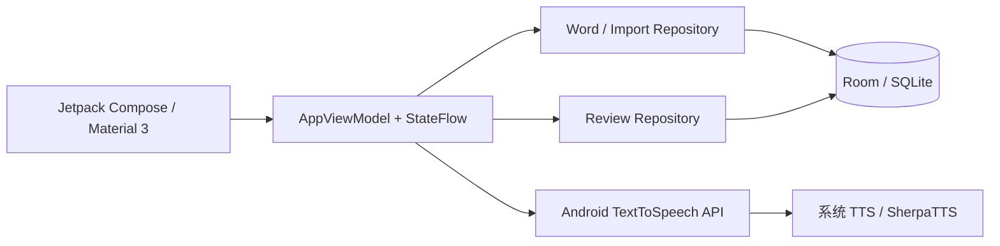

# MyWords

MyWords 是一款原生 Android 本地生词复习应用，面向从 Google 翻译收藏等来源导出的四列 CSV 单词表。它支持多个独立词库、识别与拼写两阶段复习、跨词库共享记忆、未完成进度恢复，以及 Android 系统文字转语音（TTS）。

应用本身不要求账号，也不声明 `INTERNET` 权限。单词、词库和复习记录保存在手机的 Room/SQLite 数据库中。

## 当前开发状态

截至 2026-08-27，仓库 `main` 分支对应的应用版本为 **v1.1.2**（`versionCode 4`，数据库版本 3）。

| 项目 | 当前情况 |
| --- | --- |
| 可安装版本 | [MyWords v1.1.2](https://github.com/jinglangqiu-hub/PersonalWordReviewApp/releases/tag/v1.1.2) 已发布，提供正式签名 APK |
| 支持系统 | MyWords 最低 Android 8.0（API 26），目标 Android 15（API 35） |
| 已实现 | 多词库管理、按词库导入/更新、词条搜索和释义编辑、双阶段复习、错题循环、进度恢复/重开/跳过、共享复习记忆、记忆重置、系统 TTS 诊断、软件内置拼写键盘 |
| 最近验证记录 | 2026-08-27：6 个 JVM 单元测试全部通过，`lintDebug` 为 `No issues found`，Debug、AndroidTest 和正式签名 Release APK 均已生成；发布 APK 的哈希与下方记录一致 |
| 自动化检查范围 | JVM 单元测试覆盖 CSV、调度和干扰项；Android 测试覆盖数据库迁移、记忆重置、幂等保存、会话清理和 TTS voice 排序 |


### 已知边界

- 当前仅支持**逗号分隔、固定四列**的 CSV；不直接读取 XLSX、TSV，也没有导入列映射界面。
- 复习数量可以超过当前已到期词数；此时算法会继续选取尚未到期但优先级最高的词。
- 选择题必须能找到两个不同的错误释义，因此所选词库至少需要 3 个不同的非空释义。
- 数据只存于应用本地；当前没有账号同步、数据库导出或自动云备份。应用还显式关闭了 Android 云备份和设备迁移。卸载前请保留原始 CSV。
- 仓库未配置应用商店发布流程，目前通过 GitHub Releases 分发 APK。

## 下载和安装

### 直接下载

- 最新版本：[下载 MyWords v1.1.2 APK](https://github.com/jinglangqiu-hub/PersonalWordReviewApp/releases/download/v1.1.2/app-release.apk)
- 全部版本：[GitHub Releases](https://github.com/jinglangqiu-hub/PersonalWordReviewApp/releases)
- v1.1.2 APK SHA-256：`0cfddf399b507be50cd08f0bcb9fcc3a367eb9872ba2a105093aad4ad4a60f72`

建议从 Releases 页面进入下载，并确认域名和仓库为 `github.com/jinglangqiu-hub/PersonalWordReviewApp`。

### 安装步骤

1. 在 Android 手机上下载 `app-release.apk`，或先在电脑下载后传到手机。
2. 用浏览器或文件管理器打开 APK。
3. 如果系统阻止安装，按提示允许当前浏览器或文件管理器“安装未知应用”。
4. 返回安装页面完成安装，然后打开 **MyWords**。

Android 对侧载 APK 的风险提示是正常行为。后续版本必须继续使用同一签名，且 `versionCode` 不能低于手机上已安装的版本；不要卸载旧版本后再升级，否则本地数据会一并删除。

## 建议配合 SherpaTTS 使用

MyWords 通过 Android 标准 `TextToSpeech` API 调用**系统当前选中的 TTS 引擎**，并没有把语音模型打包进 APK。若手机原有英文语音效果不理想，建议安装开源的 [SherpaTTS](https://github.com/woheller69/ttsengine)。它基于 sherpa-onnx，使用 Piper 或 Coqui voice；模型下载完成后可以离线合成。

推荐配置流程：

1. 从 [F-Droid 的 SherpaTTS 页面](https://f-droid.org/packages/org.woheller69.ttsengine/) 安装 SherpaTTS。F-Droid 当前版本要求 Android 10 或更高；Android 8/9 用户需要继续使用设备自带或其他兼容 TTS 引擎。
2. 首次打开 SherpaTTS，在 **Manage Languages** 中下载一个英文 voice。此步骤需要联网，模型文件可能较大。
3. 进入 Android 系统的“文字转语音输出”设置，将 **SherpaTTS** 设为首选引擎，并试听英文语音。
4. 回到 MyWords，打开首页的“语音设置”，点击“重新检测”。检测信息中应能看到 SherpaTTS 的引擎包、英文 locale 和离线 voice 状态。
5. 在选择题或拼写题点击“发音”测试。

MyWords 自身仍然不联网；SherpaTTS 的模型下载和存储由 SherpaTTS 独立负责。如果已经下载模型但没有声音，依次检查系统媒体音量、系统默认 TTS 引擎、英文 voice 是否安装，以及 MyWords“语音设置”中的错误信息。

## CSV 准备与导入

### 文件格式

每条记录使用下面四列。应用只读取前四列：

| 列 | 内容 | 示例 |
| --- | --- | --- |
| 1 | 源语言 | `英语` |
| 2 | 目标语言 | `中文（简体）` |
| 3 | 英文单词或短语 | `auction` |
| 4 | 中文释义 | `拍卖` |

可以使用无表头文件：

```csv
英语,中文（简体）,auction,拍卖
英语,中文（简体）,stunned,目瞪口呆
英语,中文（简体）,take off,起飞
```

也可以把可识别表头放在第一行：

```csv
源语言,目标语言,英文,释义
英语,中文（简体）,auction,拍卖
```

解析器当前支持：

- UTF-8、带 BOM 的 UTF-8、UTF-16LE、UTF-16BE，以及 UTF-8 解码失败时的 GB18030 回退。
- 标准 CSV 双引号、字段内逗号、双引号转义和引号字段内换行。
- 空行跳过；缺列、英文为空、释义为空、引号未闭合会计入失败统计，并显示部分失败行号。

### 去重和更新规则

英文会先执行 `trim → 合并连续空白 → lowercase`，得到全局唯一的 `normalizedTerm`。例如 ` Take   Off ` 与 `take off` 会被视为同一个词。

- 同一个英文可以同时加入多个词库。
- 各词库分别保存该词在本词库中的显示形式、语言和释义。
- 同一词库再次导入相同英文时不会重复建项；新释义会用中文分号 `；` 追加，完全相同的释义不会重复追加。
- 识别/拼写记忆和“不再拼写”设置绑定到全局单词，因此在所有词库间共享。
- 删除词库后，只属于该词库的单词会成为孤立词并被清理；仍属于其他词库的单词和共享记忆会保留。

### 导入步骤

1. 首页点击“管理单词库 / 导入”。
2. 新建词库，或在已有词库旁点击“导入/更新”。
3. 点击“选择文件”，通过 Android 系统文件选择器选择 CSV。
4. 查看导入结果中的总行数、新增、已有、释义更新、失败原因、示例行号和检测编码。
5. 进入词库，用英文或中文搜索并抽查释义。

这里的“新增单词”指**新加入当前词库**的数量；该英文可能已经存在于另一个词库。

## 日常使用

### 管理词库和词条

- 可以新建、重命名和删除词库，至少保留一个词库。
- 可以单独更新任意词库；导入记录会关联到目标词库。
- 词条详情支持编辑当前词库的释义。
- “不再进入拼写阶段”是全局设置，适合只需阅读识别的长词、短语或专有名词。

### 开始复习

1. 首页点击“开始复习”。
2. 选择一个词库。
3. 输入本次复习数量；数量不能大于该词库中带非空释义的单词数。
4. 先完成选择题，再完成拼写题。

选择题显示英文和 3 个中文释义；拼写题显示中文释义，并通过软件内置 QWERTY 键盘输入英文。拼写阶段的输入框为只读，不会拉起系统输入法；键盘支持字母、空格、连字符、撇号、句点、退格和清空。

每个阶段中，答错词会进入下一轮，直到本阶段没有错题。完成后会显示实际复习数量、两个阶段的轮数和错误次数。

### 中途退出

应用持久化当前阶段、轮次、题目位置和错题集合。下次打开时可以：

| 操作 | 结果 |
| --- | --- |
| 继续进度 | 从保存位置继续 |
| 重新开始 | 回滚这次未完成会话对记忆状态的修改，然后重做同一批词 |
| 跳过 | 回滚记忆修改并把该会话标记为已放弃 |

“重置我的复习记忆”会清除全部单词的间隔、到期时间、遗忘次数、连续正确次数，并放弃未完成进度；词库、词条、释义、导入记录和“不再拼写”设置保留。

## 复习算法

这是一套面向当前应用流程的自定义间隔复习算法，不应表述为标准 SM-2 的完整实现。

### 1. 两套共享记忆

每个全局单词分别维护：

- `recognition`：选择题记忆。
- `spelling`：拼写题记忆。

状态包含 `easeFactor`、`intervalDays`、`dueAt`、`lapseCount`、`successStreak` 和 `lastReviewedAt`。同一英文出现在多个词库时复用这两套状态；当前选词排序只读取 `recognition` 状态。

### 2. 本次选词

对所选词库中有非空释义的词计算优先级：

```text
priority = dueBoost + lapseCount × 10,000 - successStreak × 1,000
dueBoost = 1,000,000  （从未复习或已经到期）
           0          （尚未到期）
```

按 `priority` 从高到低排序；分数相同则优先选择在该词库中更早更新的词，最后截取用户要求的数量。因此整体顺序是：到期/新词优先，其次偏向遗忘更多、连续答对更少的词。

### 3. 记忆更新

初始 `easeFactor = 2.5`，`intervalDays = 0`。

答对时：

```text
连续答对 1 次：间隔 1 天
连续答对 2 次：间隔 3 天
连续答对 3 次及以后：max(5, floor(旧间隔 × 旧 easeFactor)) 天
easeFactor = min(3.0, easeFactor + 0.08)
```

答错时：

```text
间隔重置为 1 天
easeFactor = max(1.3, easeFactor - 0.2)
lapseCount += 1
successStreak = 0
```

每次回答都会写入对应阶段的记忆；同一会话的错题在后续轮次再次回答时也会继续更新。

### 4. 选择题干扰项

每题需要两个不同释义作为干扰项。算法先比较目标词与候选词的标准化英文，综合以下信号选择视觉拼写最相似的词：

- Damerau-Levenshtein 编辑距离，包括相邻字符换位。
- 字符 bigram 的 Dice 相似度。
- 公共前缀、公共后缀、长度接近程度和首字母相同奖励。

选出的两个释义与正确释义再随机打乱。这样会优先生成更容易混淆、但释义仍互不相同的选项。

### 5. 拼写判定

用户答案使用与导入相同的标准化规则：忽略首尾空白、忽略大小写、把连续空白合并成一个。除此之外必须完全一致。

例如标准答案是 `take off`：`Take Off` 和 ` take   off ` 可通过，`takeoff` 不通过。

## 技术路径



| 层 | 实现 |
| --- | --- |
| UI | 单 Activity，Jetpack Compose，Navigation Compose，Material 3 |
| 状态 | `AndroidViewModel`、Kotlin Coroutines、`StateFlow` |
| 数据 | Room 2.6.1 / SQLite；DAO + Repository；数据库 schema 3，提供 1→2、2→3 迁移 |
| 构建 | Kotlin 1.9.24、KSP 1.9.24-1.0.20、AGP 8.7.3、Gradle Wrapper 8.9、JVM target 17 |
| Android | `minSdk 26`、`targetSdk 35`、`compileSdk 35` |
| 语音 | Android `TextToSpeech`；优先可用的已安装离线英文 voice，失败时回退到引擎兼容模式并显示诊断 |
| 隐私 | Manifest 不含 `INTERNET`；`allowBackup=false`，备份/设备迁移规则排除数据库、配置和文件 |

核心数据库关系：

- `words` 保存按标准化英文唯一的全局词身份。
- `word_libraries` 与 `library_words` 建立多对多词库关系，并允许每个词库保存自己的释义。
- `memory_states` 以 `(wordId, type)` 唯一，构成跨词库共享记忆。
- `review_sessions`、`review_progress`、`review_results` 保存会话、断点和作答。
- `review_memory_snapshots` 保存会话开始前的记忆快照，用于重开或跳过时回滚。

## 源码构建与调试

### Android Studio

1. 安装 Android Studio 和 Android SDK 35。
2. 克隆仓库并在 Android Studio 中打开根目录。
3. 等待 Gradle Sync 完成。
4. 选择 `app` 的 Debug 配置和一台 Android 8.0+ 设备/模拟器，点击 Run。

### Windows PowerShell

可使用 Android Studio 自带 JBR：

```powershell
$env:JAVA_HOME = 'C:\Program Files\Android\Android Studio\jbr'
$env:ANDROID_HOME = "$env:LOCALAPPDATA\Android\Sdk"
$env:ANDROID_SDK_ROOT = $env:ANDROID_HOME
$env:PATH = "$env:JAVA_HOME\bin;$env:ANDROID_HOME\platform-tools;$env:PATH"

.\gradlew.bat testDebugUnitTest lintDebug assembleDebug assembleAndroidTest --no-daemon
```

Debug APK 输出：

```text
app/build/outputs/apk/debug/app-debug.apk
```

`assembleAndroidTest` 只编译设备测试 APK；真正执行 `connectedDebugAndroidTest` 需要已连接设备或正在运行的 AVD。

### Release 签名

仓库不包含发布密钥。没有 `keystore.properties` 时，`assembleRelease` 只会生成未签名 APK；正式分发必须使用项目维护者保存的同一发布密钥。

首次建立自己的发布身份时，可以复制 `keystore.properties.example` 手动配置，或审阅后运行：

```powershell
.\scripts\create_release_keystore.ps1
.\gradlew.bat assembleRelease --no-daemon
```

脚本会拒绝覆盖已有密钥。`*.jks`、`*.keystore` 和 `keystore.properties` 已被 `.gitignore` 排除；请将密钥和密码配置分别备份到至少两个加密且相互独立的位置。丢失原密钥后，新 APK 将无法覆盖安装原签名版本。

## 主要源码位置

```text
app/src/main/java/com/example/wordreview/
├── MainActivity.kt                 # Compose 页面、导航和软件内置键盘
├── ui/AppViewModel.kt              # 页面状态、复习流程和断点恢复
├── domain/Core.kt                  # CSV、标准化、选词、干扰项和记忆算法
├── data/local/                     # Room 数据库、Entity、DAO 和迁移
├── data/repository/Repositories.kt # 词库、导入和复习事务
└── tts/TtsManager.kt               # 系统 TTS 选择、诊断、发音和重试
```

项目仓库：[jinglangqiu-hub/PersonalWordReviewApp](https://github.com/jinglangqiu-hub/PersonalWordReviewApp)
